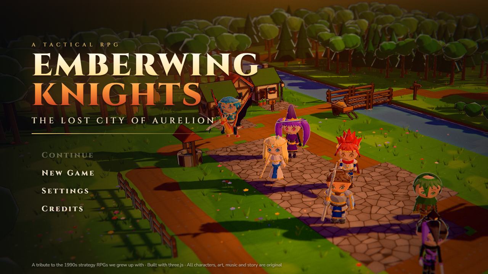
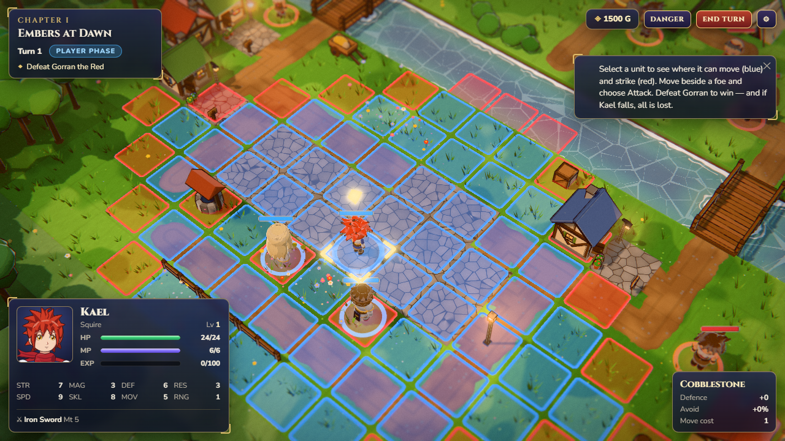
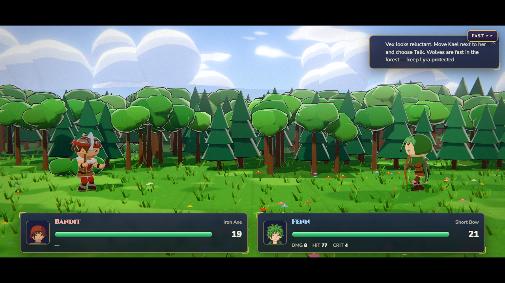
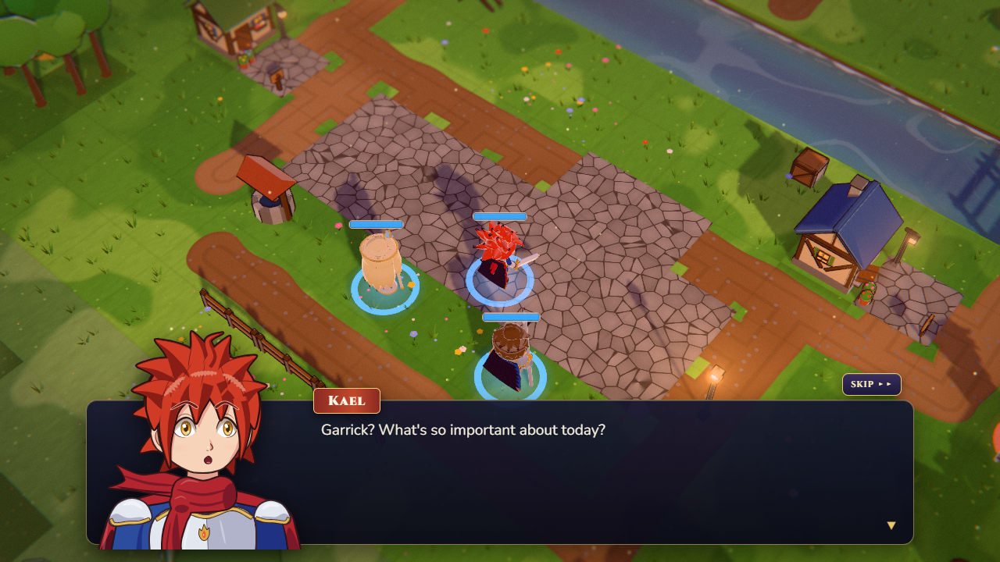
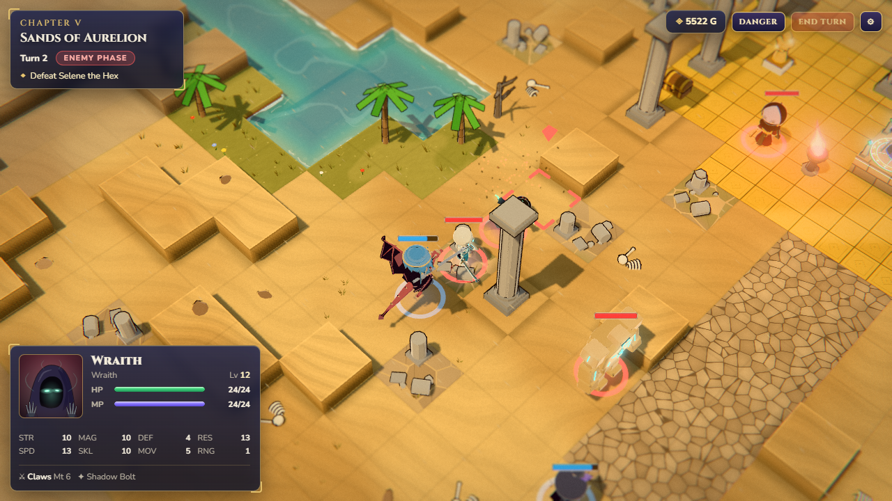

# Emberwing Knights — The Lost City of Aurelion

**▶ Play in your browser: https://peterxing.github.io/emberwing-knights/**

An anime-style tactical RPG built with **three.js** — a love letter to the 1990s Taiwanese and Japanese strategy RPGs,
especially *Flame Dragon Knights II* (炎龍騎士團2, Dynasty International, 1995). It keeps that era's formula — grid
tactics, side-view battle cutscenes, big anime portraits in story scenes, class changes and hidden treasure — and
rebuilds it with modern presentation: cel-shaded 3D dioramas, dynamic lighting and shadows, bloom, tilt-shift depth of
field, particle spell effects and a fully synthesised orchestral soundtrack.

> All characters, story, art and music are original. Nothing from the original games is used.



| Tactics map | Battle cutscene |
| --- | --- |
|  |  |
| **Story scenes** | **Sands of Aurelion** |
|  |  |

## The story

Thirty years ago the Emberwing Knights — riders of flame-scaled wyverns — sealed the Gloom Wyrm beneath the golden
city of Aurelion. Now the Obsidian Empire's Chancellor Malzaar hunts the last key to that seal: the Ember Crest,
carried by a young villager named **Kael Ardent**. Six chapters take Kael and his companions from a burning river
village to the heart of the lost city.

**The company:** Kael (Squire → Emberwing Knight) · Lyra (Cleric → Saint) · Garrick (Lancer → General) ·
Fenn (Archer → Ranger) · Vex (Rogue → Shadowblade, recruitable) · Mira (Mage → Archmage) · Sora (Wyvern Rider → Wyvern Lord)

## Features

- **6 story chapters** with scripted events: reinforcements, a recruitable enemy, a prison break, a summoner who raises
  the dead every other turn, and a two-phase final boss.
- **Classic SRPG rules:** terrain defence/avoid, height advantage, weapon ranges, speed-based double attacks,
  counter-attacks, critical hits, bows effective against flyers, holy magic effective against the undead,
  area spells, healing, villages, chests and **hidden treasure** (Vex can sense it).
- **Growth:** EXP and randomised level-ups, automatic **class change at level 10** with a unique weapon per hero,
  stat seeds, a shop and equipment at camp between chapters, autosave.
- **FD2-style battle cutscenes:** every fight cuts to a side-view stage themed to the terrain (fields, forests, castle
  halls, deserts, bridges, golden temples), with choreographed camera moves, hit-stop, spell effects and HP panels.
  Prefer speed? Switch to quick on-map animations in Settings.
- **Presentation:** cel shading with screen-space outlines, rim light, procedural terrain shaders, animated water and
  lava, swaying foliage, eight sky/lighting presets (dawn → volcanic twilight), bloom, tilt-shift and colour grading.
- **Everything is procedural** — 3D characters and monsters, 30 anime portraits with 11 expressions each (SVG),
  12 music tracks and ~40 sound effects (Web Audio). No image, model or audio files are shipped.

## Controls

| Action | Mouse / touch | Keyboard |
| --- | --- | --- |
| Select, move, act | Left click / tap | Arrows + Enter |
| Cancel / undo move | Right click | Esc |
| Pan camera | Drag | W A S D |
| Rotate / tilt | Right-drag (or two-finger twist) | Q / E |
| Zoom | Wheel / pinch | + / − |
| Next ready unit | — | Tab |
| Enemy danger zone | **Danger** button | R |

Tip: clicking an enemy inside your red range moves you to the best tile and opens the battle forecast.

## Run locally

```bash
npm install
npm run dev        # http://localhost:5173
npm run build      # production build in dist/
npm run validate   # checks every chapter map, placement and route
npm run simulate   # AI-vs-AI balance simulation for all chapters
```

Developer URL flags: `?chapter=3` (jump to a chapter with a levelled party), `&auto=1` (AI plays your side),
`&anim=map` (quick battles), `&skip=1` (skip dialogue), `&speed=2`, `?campOnly=4`.

## Project layout

```
src/
  core/      engine (renderer + post-processing), camera rig, input, tweens
  gfx/       toon shading, world/terrain builder, sky & lighting, cutscene arenas,
             characters & monsters, VFX, SVG portraits, map overlays
  game/      rules (board, combat, AI), battle controller & scripting, cutscenes, save state
  game/data  classes, items, spells, heroes, cast appearances, terrain, the six chapters
  audio/     Web Audio sequencer, instruments, compositions and sound effects
  ui/        HUD, dialogue, title, camp, settings
tools/       chapter validator, balance simulator, headless screenshot/e2e scripts
```

Deployed automatically to GitHub Pages by `.github/workflows/pages.yml` on every push to `main`.

## Credits

Design & development by Peter Xing with GitHub Copilot. Built with [three.js](https://threejs.org) and
[Vite](https://vitejs.dev). Fonts: Cinzel and Nunito (Google Fonts).

*Flame Dragon Knights* is a trademark of its respective owner; this fan-made tribute is not affiliated with or endorsed by them.

Code released under the [MIT License](LICENSE).
